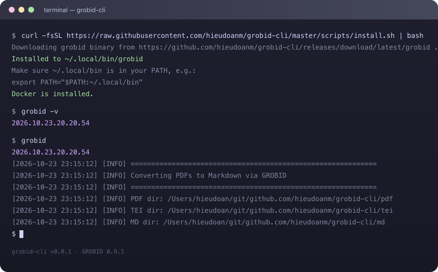

# Grobid CLI


Convert PDF articles to Markdown so AI can work better with them. Built upon [GROBID](https://github.com/grobidOrg).

## The Problem

AI models struggle to extract clean, structured content from PDFs. Raw PDFs are messy — headers, footers, citations, tables, and figures make it hard for LLMs to parse and reason about academic papers or documents.

## The Solution

grobid cli uses [GROBID](https://github.com/grobidOrg) (GeneRation Of BIbliographic Data) to extract structured content from PDFs and convert them to clean Markdown with rich metadata in frontmatter. This makes documents AI-friendly and easy to process.

## Features

- **PDF → TEI → Markdown**: Full conversion pipeline using GROBID's TEI XML extraction
- **Auto-starts GROBID**: Automatically launches a GROBID Docker container if not already running
- **Rich metadata**: Extracts title, authors, journal, year, volume, issue, pages, DOI and adds them as YAML frontmatter
- **Structured output**: Preserves abstract, article sections, references, tables, lists, and formulas
- **Simple CLI**: One command to convert all PDFs in `pdf/` directory
- **Resumable**: Skips already converted TEI/XML and Markdown files

## Quick Start

### Prerequisites

- [Docker](https://www.docker.com/) (for auto-starting GROBID)
- Python 3.15

### Installation

#### Option 1: Prebuilt binary

```bash
# Download the latest binary
curl -fsSL https://github.com/hieudoanm/grobid-cli/releases/download/latest/grobid -o /usr/local/bin/grobid
chmod +x /usr/local/bin/grobid
```

Or use the install script (checks for Docker and prompts to install if missing):

```bash
curl -fsSL https://raw.githubusercontent.com/hieudoanm/grobid-cli/master/packages/cli/scripts/install.sh | bash
```

#### Option 2: From source

```bash
pip install -e .
# or
uv pip install -e .
```

#### Docker

Grobid CLI requires Docker to run the GROBID service. Install Docker separately:

- **macOS**: [Docker Desktop for Mac](https://docs.docker.com/docker-mac/install/) or `brew install --cask docker`
- **Linux**:
  - Arch: `sudo pacman -S docker docker-compose`
  - Debian/Ubuntu: `sudo apt-get install -y docker.io docker-compose`
  - RHEL/Fedora: `sudo dnf install -y docker docker-compose`
- **Windows**: [Docker Desktop for Windows](https://docs.docker.com/docker-windows/install/)

### Usage

1. Put your PDFs in a `pdf/` directory
2. Run the converter
3. Get TEI XML in `tei/` and Markdown in `md/`



```bash
grobid
```

Or set a custom data directory:

```bash
GROBID_DATA_DIR=/path/to/data grobid
```

### Output Example

```markdown
---
title: "Paper Title"
authors: "Author One, Author Two"
year: 2024
journal: "Journal Name"
volume: "10"
doi: "10.1234/example"
doi_link: "https://doi.org/10.1234/example"
---

# Paper Title

**Authors:** Author One, Author Two

## Abstract
...

## Article
...

## References
...
```

## Directory Structure

```
your-project/
├── pdf/          # Input PDFs
├── tei/          # Generated TEI XML (intermediate)
└── md/           # Output Markdown files
```

## Environment Variables

| Variable                                | Default                   | Description                                     |
| --------------------------------------- | ------------------------- | ----------------------------------------------- |
| `GROBID_DATA_DIR` / `ARTICLES_DATA_DIR` | Current directory         | Data directory containing `pdf/`, `tei/`, `md/` |
| `GROBID_PORT`                           | `8070`                    | Port for GROBID server                          |
| `GROBID_IMAGE`                          | `grobid/grobid:0.9.1-crf` | Docker image for GROBID                         |
| `GROBID_CONTAINER`                      | `grobid-cli`              | Docker container name                           |

## Development

```bash
make lint    # Run linters
make format  # Format code
make test    # Run tests
make build   # Build binary with PyInstaller
```

### Assets

Generate PNG assets from SVG sources:

```bash
bash assets/svg-to-png.sh assets
```

## Why Grobid CLI?

The problem: AI does not work well with PDFs. Raw PDF text extraction loses structure, citations break context, and formatting confuses models.

The solution: Grobid CLI leverages GROBID's state-of-the-art PDF parsing to produce clean, structured Markdown that LLMs can understand and reason about effectively.

## License

[MIT License](LICENSE)
